# BÀI KIỂM TRA CUỐI KHÓA

## ĐỒ ÁN: TẠO WEBSITE VỀ MỘT THƯƠNG HIỆU

# WEBSITE NHÀ SÁCH "MẦM CHỮ"
*Gieo chữ hôm nay, gặt tương lai ngày mai.*

| Thông tin | Nội dung |
|---|---|
| Học viên | Phạm Mạch Lam Phương |
| Điện thoại | 0933614895 |
| Email | phuongpham011195@gmail.com |
| Lớp / Khóa học | KHTN_AVC1_316C7N |
| Giảng viên | Nguyễn Việt Hải |
| Website (đã deploy) | https://phuongpham011195.github.io/mam-chu/ |
| GitHub (Public) | https://github.com/phuongpham011195/mam-chu |
| Ngày nộp | *(điền)* |

> **Cách chèn ảnh:** chụp ảnh theo bảng ở cuối file (phần *Phụ lục – Danh sách ảnh cần chụp*), lưu vào thư mục `anh/` đúng tên file. Các dòng `` bên dưới sẽ tự hiện ảnh khi file tồn tại. Khi xuất PDF, kiểm tra không còn ô ảnh trống.

---

## MỤC LỤC

1. [Mô tả dự án](#1-mô-tả-dự-án)
   - 1.1. [Logo thương hiệu](#11-logo-thương-hiệu)
2. [Các trang trong dự án](#2-các-trang-trong-dự-án)
   - 2.1. [Trang Chủ](#21-trang-chủ)
   - 2.2. [Trang Danh mục sách](#22-trang-danh-mục-sách)
   - 2.3. [Trang Chi tiết sách](#23-trang-chi-tiết-sách)
   - 2.4. [Trang Giỏ hàng](#24-trang-giỏ-hàng)
   - 2.5. [Trang Về Chúng Tôi](#25-trang-về-chúng-tôi)
   - 2.6. [Trang Chính sách](#26-trang-chính-sách)
   - 2.7. [Trang Quản trị](#27-trang-quản-trị)
3. [Các chức năng được thực hiện](#3-các-chức-năng-được-thực-hiện)
   - 3.1. [Database Supabase](#31-database-supabase)
   - 3.2. [Danh sách chức năng](#32-danh-sách-chức-năng)
   - 3.3. [Bảo mật](#33-bảo-mật)
   - 3.4. [Kiểm thử](#34-kiểm-thử)
4. [Các file .md và chức năng](#4-các-file-md-và-chức-năng)
5. [Thứ tự các prompt và kết quả](#5-thứ-tự-các-prompt-và-kết-quả)
6. [Thông tin nộp bài](#6-thông-tin-nộp-bài)
7. [Phụ lục – Danh sách ảnh cần chụp](#phụ-lục--danh-sách-ảnh-cần-chụp)

---

## 1. Mô tả dự án

| Hạng mục | Nội dung |
|---|---|
| Lĩnh vực | Bán lẻ sách – nhà sách trực tuyến cho trẻ em và phụ huynh |
| Thương hiệu | **Mầm Chữ** (thương hiệu hư cấu), slogan *"Gieo chữ hôm nay, gặt tương lai ngày mai."* |
| Sản phẩm giới thiệu | 16 cuốn sách hư cấu thuộc 4 thể loại: **Thiếu nhi**, **Văn học**, **Kinh tế**, **Kỹ năng**. Mỗi sách có chip độ tuổi ("3–6 tuổi" hoặc "Dành cho phụ huynh"). |
| Mục tiêu website | Giúp phụ huynh chọn sách đúng độ tuổi và kỹ năng cho con, đặt hàng thanh toán khi nhận hàng (COD) không cần đăng ký tài khoản, và để lại đánh giá. Chủ nhà sách (Admin) xử lý đơn, kiểm duyệt đánh giá, thêm sách và chỉnh giá, tồn kho. |
| Công nghệ | HTML + CSS + JavaScript thuần (ES Modules, không framework, không bước build); Tailwind CSS qua CDN (ghim `3.4.16`); `supabase-js` `2.45.4` qua CDN; Database: Supabase (PostgreSQL + Auth); Deploy: GitHub Pages |
| Cách làm | Toàn bộ tài liệu và mã nguồn được tạo bằng prompt (vibe code). Các prompt được lưu nguyên văn trong thư mục `Prompts/`. |

### 1.1. Logo thương hiệu

Vì là thương hiệu hư cấu, logo được thiết kế trước và dùng thống nhất trên toàn bộ website (Navbar, Footer, trang Về Chúng Tôi, trang xác nhận đơn, favicon):

- **Biểu tượng:** một cuốn sách mở ra, từ gáy sách nảy lên một mầm cây hai lá. Sách là "chữ", mầm là "trẻ đang lớn", khớp với tên và slogan.
- **Chữ:** "Mầm Chữ" phông Baloo 2 đậm, giữ nguyên dấu tiếng Việt.
- **Màu:** xanh ngọc `#0F766E` (chủ đạo), vàng nắng `#F5B82E` (điểm nhấn), nền kem `#FFFBF2`. Font nội dung Nunito.
- **Các phiên bản** (thư mục `assets/brand/`): `logo-horizontal.svg` (Navbar), `logo-horizontal-white.svg` (Footer nền xanh ngọc tối), `logo.svg` (dọc, trang Về Chúng Tôi), `favicon.svg`.

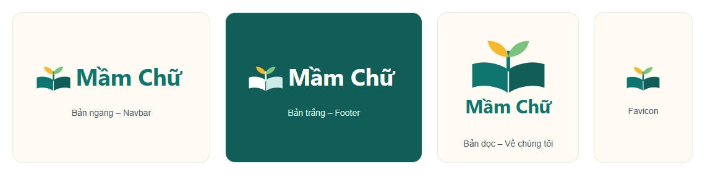

---

## 2. Các trang trong dự án

| Trang | Đường dẫn | Nội dung chính |
|---|---|---|
| Trang Chủ (Home) | `index.html` | Hero với slogan, thẻ 4 thể loại, sách nổi bật, cách đặt hàng 3 bước, Góc phụ huynh, kêu gọi hành động |
| Danh mục sách (Books) | `books.html` | Lưới sách, lọc theo thể loại, tìm theo tên hoặc tác giả (không phân biệt hoa thường và dấu), giá, giá gốc gạch ngang, badge giảm giá, tình trạng còn hàng |
| Chi tiết sách (Detail) | `book.html?slug=<slug>` | Thông tin sách, giá, nút "Thêm vào giỏ" và "Mua ngay", đánh giá (xem và viết), điểm trung bình, breadcrumb; slug không tồn tại thì hiện thông báo thân thiện |
| Giỏ hàng (Cart) | `cart.html` | Giỏ lưu trong `localStorage`, đổi số lượng, xóa, form đặt hàng COD, màn hình xác nhận đơn |
| Về Chúng Tôi (About Us) | `about.html` | Logo, câu chuyện thương hiệu, sứ mệnh, giá trị, thông tin liên hệ mẫu, Google Map |
| Chính sách (Policy) | `chinh-sach.html` | Chính sách giao hàng, đổi trả, vận chuyển miễn phí (dữ liệu mẫu, trang tĩnh) |
| Quản trị (Admin) | `admin.html` | Đăng nhập email và mật khẩu; 3 tab: Đơn hàng, Đánh giá, Sách |

**Liên kết giữa các trang:** Navbar (Trang chủ • Sách • Về chúng tôi • Giỏ hàng kèm số lượng) và Footer (có liên kết Chính sách và liên kết nhỏ "Quản trị") xuất hiện trên mọi trang. Trang chủ dẫn tới danh mục theo thể loại và chi tiết từng sách; trang Chi tiết có breadcrumb *Trang chủ › Sách › Thể loại › Tên sách*; "Mua ngay" chuyển sang giỏ hàng; Admin đăng xuất thì về Trang chủ. Mọi đường dẫn đều tương đối nên chạy đúng trên GitHub Pages.

### 2.1. Trang Chủ


### 2.2. Trang Danh mục sách

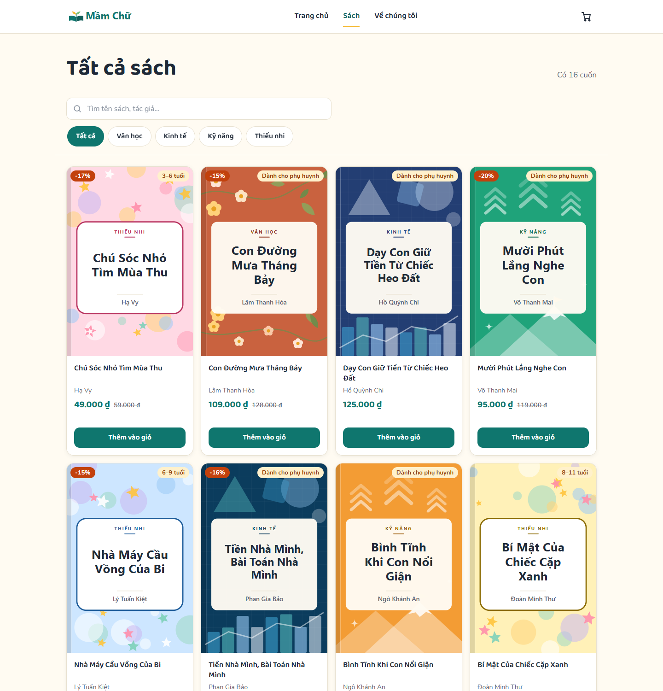

### 2.3. Trang Chi tiết sách


### 2.4. Trang Giỏ hàng

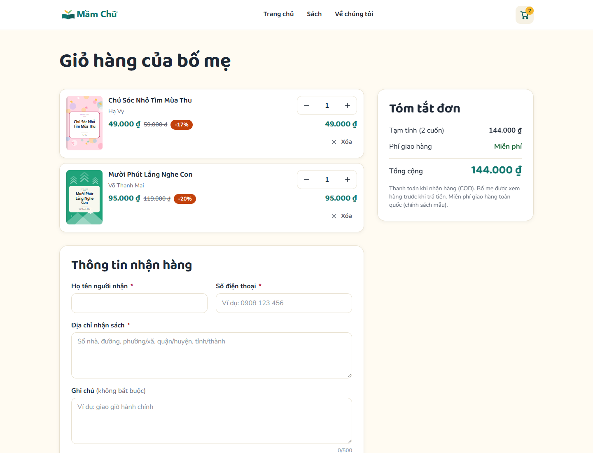

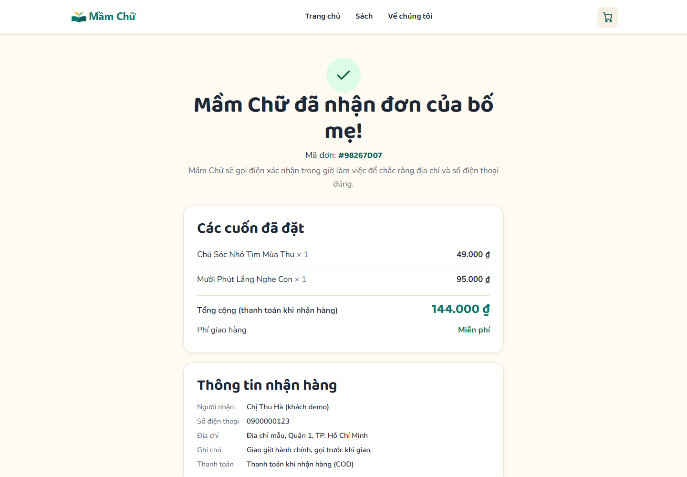

### 2.5. Trang Về Chúng Tôi


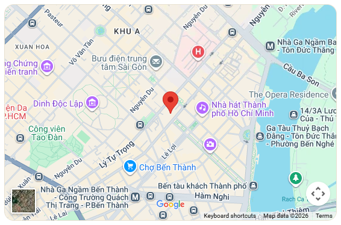

### 2.6. Trang Chính sách


### 2.7. Trang Quản trị

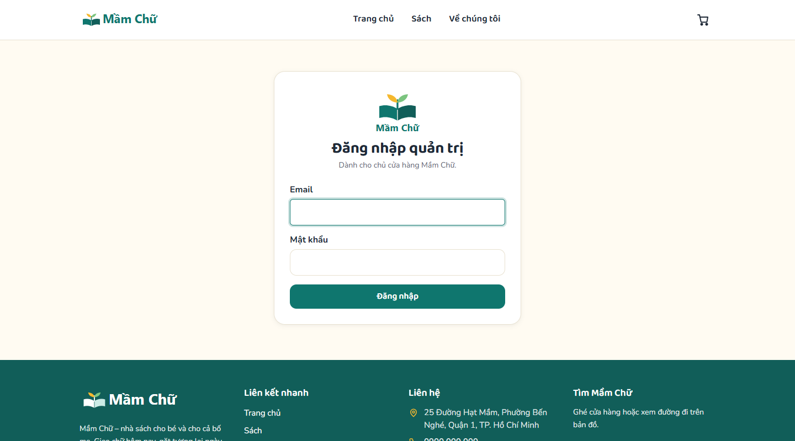

**Giao diện trên điện thoại (360 px):** các trang đều dùng được trên điện thoại; Navbar thu gọn thành menu trượt, lưới sách xếp lại theo bề rộng màn hình, trang không bị cuộn ngang.

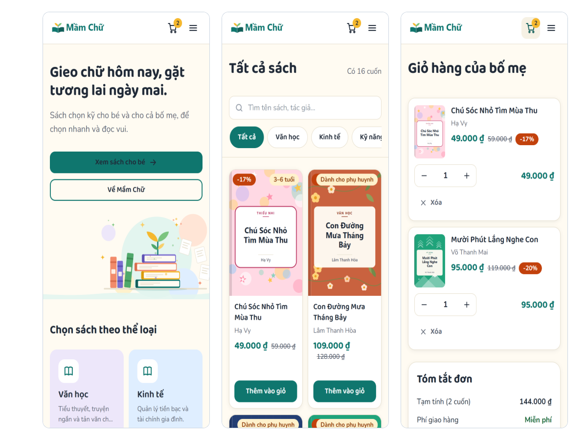

---

## 3. Các chức năng được thực hiện

### 3.1. Database Supabase

Dự án dùng Supabase (cơ sở dữ liệu PostgreSQL trên đám mây) với **5 bảng**. Bảo mật bằng Row Level Security (RLS – quy tắc phân quyền theo từng dòng dữ liệu) với **11 policy**: khách chỉ được xem và gửi dữ liệu theo đúng quy tắc, chỉ Admin đã đăng nhập mới được sửa và xóa. Script tạo bảng và policy: `supabase/schema.sql`, `supabase/policies.sql`.

```
categories 1 ──< books 1 ──< reviews
                   └──< order_items >── 1 orders
```

| Bảng | Dữ liệu | Quyền |
|---|---|---|
| `categories` | 4 thể loại: tên, slug, mô tả, thứ tự hiển thị | Khách: xem. Admin: toàn quyền |
| `books` | 16 sách: tên, slug, tác giả, nhà xuất bản, năm, số trang, độ tuổi, giá bán, giá gốc, tồn kho, ảnh bìa, nổi bật, đang bán | Khách: xem sách đang bán. Admin: toàn quyền (kể cả sách đang ẩn) |
| `orders` | Đơn hàng: họ tên, số điện thoại, địa chỉ, ghi chú, phương thức thanh toán (chỉ COD), trạng thái (Mới / Đang giao / Hoàn tất) | Khách: gửi (chỉ với trạng thái "Mới", thanh toán COD). Admin: xem, sửa, xóa |
| `order_items` | Dòng đơn: sách, tên sách lúc đặt, số lượng (1–20), đơn giá | Khách: gửi (đơn giá phải bằng giá hiện tại của sách). Admin: toàn quyền |
| `reviews` | Đánh giá: sách, tên người đánh giá, số sao 1–5, nội dung | Khách: xem, gửi. Admin: xem, xóa |

Điểm đáng chú ý: khách **không có quyền đọc** `orders` và `order_items`, nên mã đặt hàng chỉ gọi `insert()` (không `select()`) và mã đơn được tạo ở trình duyệt bằng `crypto.randomUUID()`. Bảng `orders` không có cột tổng tiền để khách không gửi được tổng sai; tổng tiền tính bằng `SUM(quantity * unit_price)` khi hiển thị.


### 3.2. Danh sách chức năng

| STT | Chức năng | Thao tác database | Trang |
|---|---|---|---|
| 1 | Hiển thị thể loại và sách nổi bật; danh mục sách; chi tiết sách theo `slug` | SELECT (đọc) `books`, `categories` | Trang Chủ, Danh mục, Chi tiết |
| 2 | Lọc theo thể loại và tìm kiếm theo tên hoặc tác giả (bộ lọc ghi trên URL) | SELECT (đọc) `books`, `categories` | Danh mục |
| 3 | Hiển thị đánh giá và điểm trung bình (tính ở JavaScript) | SELECT (đọc) `reviews` | Chi tiết |
| 4 | Viết đánh giá, chấm 1–5 sao (có ô chống spam honeypot và giãn cách 15 giây) | INSERT (thêm) `reviews` | Chi tiết |
| 5 | Giỏ hàng: thêm, đổi số lượng, xóa; đối chiếu giá và tồn kho hiện tại trước khi đặt; sách hết hàng không thêm được | SELECT (đọc) `books` (giỏ lưu `localStorage`) | Chi tiết, Giỏ hàng |
| 6 | Đặt hàng COD: tạo đơn rồi tạo các dòng đơn; nếu lỗi giữa chừng thì giữ giỏ và thử lại dùng lại đúng mã đơn | INSERT (thêm) `orders`, `order_items` | Giỏ hàng |
| 7 | Admin đăng nhập, đăng xuất | Supabase Auth | Quản trị |
| 8 | Admin xem danh sách đơn kèm chi tiết, tổng tiền, lọc theo trạng thái | SELECT (đọc) `orders`, `order_items` | Quản trị |
| 9 | Admin đổi trạng thái đơn: Mới → Đang giao → Hoàn tất | UPDATE (sửa) `orders` | Quản trị |
| 10 | Admin xóa đơn (xóa luôn các dòng đơn) | DELETE (xóa) `orders`, `order_items` | Quản trị |
| 11 | Admin xem và xóa đánh giá không phù hợp | SELECT, DELETE `reviews` | Quản trị |
| 12 | Admin thêm sách mới (slug tự sinh từ tên, kiểm tra không trùng) | INSERT (thêm) `books` | Quản trị |
| 13 | Admin sửa giá bán, giá gốc (đặt giảm giá), tồn kho; ẩn hoặc hiện sách | UPDATE (sửa) `books` | Quản trị |
| 14 | Admin xóa sách (có hộp thoại xác nhận); đánh giá của sách xóa theo, dòng đơn cũ được giữ lại | DELETE (xóa) `books`, `reviews` | Quản trị |
| 15 | Hiển thị giá gốc gạch ngang và badge giảm giá "-X%" khi có giá gốc cao hơn giá bán | — (tính ở JavaScript) | Trang chủ, Danh mục, Chi tiết, Giỏ hàng |
| 16 | Nhúng Google Map khu vực Quận 1 | — | Về Chúng Tôi, Footer |
| 17 | Navbar, Footer, breadcrumb, số lượng giỏ hàng; nhãn "● Dữ liệu: Supabase" xác nhận dữ liệu tải từ database | — | Mọi trang |
| 18 | Trang Chính sách tĩnh (giao hàng, đổi trả, vận chuyển) | — | Chính sách |

**Đối chiếu yêu cầu 4 thao tác database**

| Thao tác | Chức năng gắn kèm |
|---|---|
| **Đọc (SELECT)** | Hiển thị sách, thể loại và đánh giá (STT 1–3) |
| **Thêm (INSERT)** | Khách đặt hàng (STT 6), khách viết đánh giá (STT 4), Admin thêm sách (STT 12) |
| **Sửa (UPDATE)** | Admin đổi trạng thái đơn (STT 9), sửa giá, giá gốc và tồn kho (STT 13) |
| **Xóa (DELETE)** | Admin xóa đơn (STT 10), xóa đánh giá (STT 11), xóa sách (STT 14) |

**Ảnh minh họa – Đọc (SELECT)**


**Ảnh minh họa – Thêm (INSERT)**


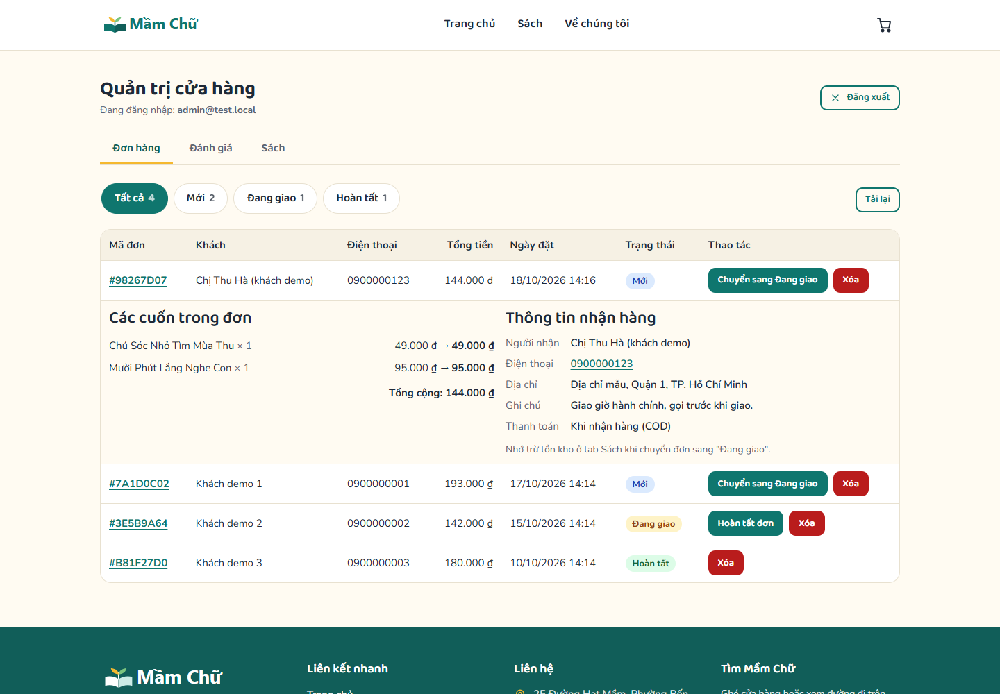


**Ảnh minh họa – Sửa (UPDATE)**


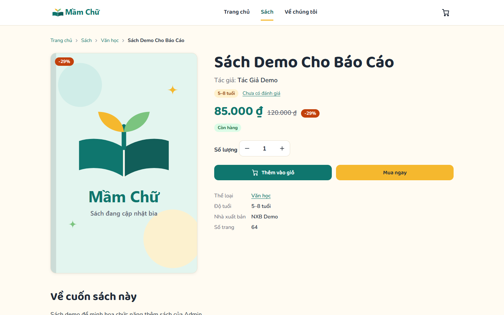

**Ảnh minh họa – Xóa (DELETE)**

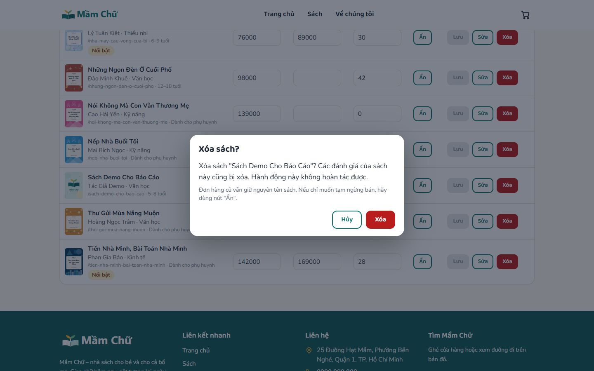

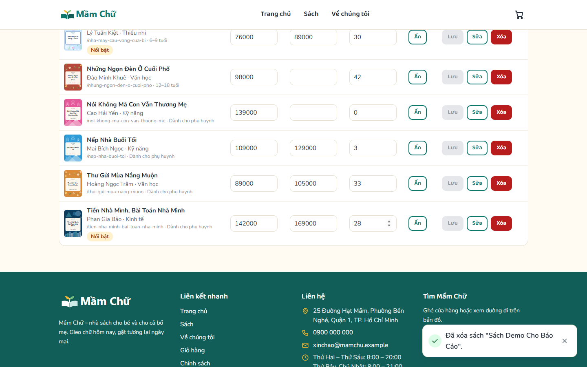

### 3.3. Bảo mật

| Hạng mục | Cách thực hiện |
|---|---|
| Khóa truy cập | Chỉ dùng khóa **anon** trong `assets/js/config.js`. Không có khóa bí mật nào trong repo (đã quét chuỗi, và giải mã khóa JWT: `role = anon`) |
| Phân quyền | RLS bật cho cả 5 bảng, 11 policy. Việc ẩn trang `admin.html` khi chưa đăng nhập chỉ là giao diện; quyền thật nằm ở RLS và Auth |
| Tài khoản admin | Tạo thủ công trong Supabase Auth; **đã tắt đăng ký công khai** (nếu để mở, ai cũng tự đăng ký và có quyền admin) |
| Chống gian lận khi đặt hàng | Policy bắt buộc trạng thái "Mới", thanh toán COD, số lượng 1–20 và đơn giá bằng giá hiện tại của sách |
| Chống XSS | Dữ liệu người dùng nhập khi hiển thị đều qua hàm thoát ký tự hoặc `textContent`; đường dẫn ảnh được lọc, chặn `javascript:` |
| Chống spam | Ràng buộc CHECK về độ dài và khoảng giá trị, ô honeypot, giãn cách 15 giây giữa hai đánh giá |


### 3.4. Kiểm thử

| Loại | Kết quả |
|---|---|
| RLS trong SQL Editor (`supabase/tests/rls-test.sql`) | 35/35 phép thử đạt, kết quả "TẤT CẢ PASS" |
| RLS qua API bằng anon key (`supabase/tests/rls-test.mjs`) | Chạy theo bảng kiểm thử policy (đọc, thêm bị từ chối, sửa và xóa bị chặn với khách) |
| Giao diện | Hơn 340 kiểm tra tự động bằng trình duyệt không giao diện trên 7 trang, gồm lọc, tìm, giỏ hàng, đặt hàng, đăng nhập admin, thêm, sửa, xóa, mất kết nối và chuỗi XSS |
| Sau deploy | Mở từng trang trên URL thật, Console không có lỗi 404 hay CORS; đặt một đơn thật, Admin xử lý rồi xóa đơn thử |


**Hạn chế đã biết:** đặt hàng là hai lệnh INSERT riêng vì không có transaction phía client (đã giảm thiểu bằng cách dùng lại mã đơn khi thử lại); tồn kho do Admin cập nhật tay; không có CAPTCHA hay giới hạn tốc độ phía server; không có thanh toán online, tài khoản khách, email, upload ảnh.

---

## 4. Các file .md và chức năng

| File | Chức năng |
|---|---|
| `README.md` | Giới thiệu dự án, cấu trúc thư mục, sơ đồ trang, hướng dẫn chạy thử, thiết lập Supabase, kiểm thử RLS và deploy. |
| `PRD.md` | Product Requirements Document (tài liệu yêu cầu sản phẩm): đánh giá khả thi các ràng buộc, mục tiêu, người dùng, sơ đồ trang, cấu trúc database, RLS, danh sách chức năng, luồng đặt hàng, các bước deploy, tiêu chí hoàn thành. |
| `DESIGN.md` | Hệ thống thiết kế: logo, bảng màu, font chữ, bố cục từng trang, thành phần giao diện (nút, thẻ sách, form, badge, navbar, footer), responsive, giọng văn. |
| `BAO_CAO.md` | Báo cáo đồ án dạng Markdown, đặt ngay trong repo GitHub (file này). |
| `content/noi-dung-website.md` | Toàn bộ nội dung chữ mẫu: về chúng tôi, banner, chính sách, thông tin liên hệ, đánh giá demo. |
| `Prompts/` | 18 prompt đã dùng theo thứ tự thực hiện (`Prompt_01` đến `Prompt_18`), kèm `00_Danh-muc-prompt.md`. Đây là phần báo cáo quá trình vibe code. |

---

## 5. Thứ tự các prompt và kết quả

Toàn bộ prompt được lưu nguyên văn trong thư mục `Prompts/` (mỗi prompt một file `Prompt_NN_*.md`). Phần đầu (Prompt 01–10) là chuẩn bị tài liệu, dữ liệu và cơ sở dữ liệu; phần sau (Prompt 11–15) là dựng giao diện; cuối cùng (Prompt 16–18) là rà soát, tài liệu và báo cáo.

| STT | Prompt | Nội dung yêu cầu | Kết quả |
|---|---|---|---|
| 1 | `Prompt_01` | Đề xuất 3 phương án thương hiệu hư cấu cho nhà sách, trình bày dạng bảng so sánh, không viết code | Bảng 3 phương án; chọn phương án C **Mầm Chữ** (slogan "Gieo chữ hôm nay, gặt tương lai ngày mai.") |
| 2 | `Prompt_02` | Viết `PRD.md` theo phương án đã chọn: công nghệ, các trang, database và RLS, 4 thao tác, deploy GitHub Pages, không lộ khóa bí mật; nêu trước ràng buộc nào không khả thi | `PRD.md`: mục 0 đánh giá 8 điểm rủi ro (ví dụ phải tắt đăng ký công khai), 20 chức năng F01–F20, 5 bảng, 11 policy RLS, luồng đặt hàng, các bước deploy, checklist hoàn thành |
| 3 | `Prompt_03` | Viết `DESIGN.md`: logo, bảng màu HEX, font tiếng Việt, bố cục từng trang, thành phần giao diện, responsive, giọng văn | `DESIGN.md`: logo cuốn sách mọc mầm, màu xanh ngọc và vàng nắng, font Baloo 2 và Nunito, bố cục 7 trang. Quyết định thêm cột `original_price` cho giá gốc; `PRD.md` được cập nhật khớp |
| 4 | `Prompt_04` | Tạo 10 cuốn sách hư cấu, 4 thể loại, xuất JSON và SQL INSERT khớp schema | Bản đầu của `books.sample.json` và `seed.sql` (được Prompt 06 thay thế) |
| 5 | `Prompt_05` | Viết nội dung chữ: Về chúng tôi, 3 phương án banner, chính sách, liên hệ mẫu, 10 đánh giá mẫu (ghi rõ là dữ liệu demo) | `content/noi-dung-website.md`, `seed_reviews.sql` (10 đánh giá lưu vào database) |
| 6 | `Prompt_06` | Làm lại bộ dữ liệu mẫu, mở rộng lên 16 cuốn sách (lần gửi trước bị ngắt giữa chừng) | `books.sample.json` và `seed.sql` với 16 sách, giữ nguyên 10 cuốn đầu |
| 7 | `Prompt_07` | Tạo file SVG: 3 logo, 2 banner 1920×640, 16 ảnh bìa theo phong cách từng thể loại; cập nhật `cover_image` | `assets/brand`, `assets/banners`, `assets/covers` (16 ảnh bìa theo slug và `default.svg`) |
| 8 | `Prompt_08` | Đối chiếu `PRD.md`, `DESIGN.md`, dữ liệu sách và nội dung chữ; chỉ báo cáo | Danh sách các điểm chưa khớp |
| 9 | `Prompt_09` | Chỉnh lại cho khớp theo phương án đơn giản và tối ưu | Các tài liệu, dữ liệu và ảnh được thống nhất (ví dụ thêm trang Chính sách, cột `original_price`, tên cột) |
| 10 | `Prompt_10` | Tạo `schema.sql`, `policies.sql`, hướng dẫn thiết lập Supabase (mục 9A), viết kiểm thử theo bảng mục 6.4 | `schema.sql` (5 bảng), `policies.sql` (11 policy), `rls-test.sql` và `rls-test.mjs`; 35/35 phép thử đạt |
| 11 | `Prompt_11` | Tạo phần dùng chung (`config.js`, `supabase.js`, `utils.js`, `icons.js`, `cart.js`, `layout.js`, `custom.css`, `.nojekyll`) và dựng Trang chủ | `index.html`, `home.js`, Navbar, Footer, giỏ hàng, nhãn "● Dữ liệu: Supabase" |
| 12 | `Prompt_12` | Dựng Danh mục sách và Chi tiết sách: lọc, tìm kiếm, đánh giá, thêm vào giỏ, các trạng thái đang tải, rỗng, hết hàng, lỗi; chống XSS | `books.html`, `book.html`, `books.js`, `book.js` (đọc sách và đánh giá, thêm đánh giá) |
| 13 | `Prompt_13` | Dựng Giỏ hàng và đặt hàng COD theo luồng 6 bước; chỉ gọi `insert()`, không `select()` trên `orders` | `cart.html`, `cart-page.js` (đối chiếu giá và tồn kho, thêm đơn và dòng đơn, thử lại không tạo đơn mồ côi) |
| 14 | `Prompt_14` | Dựng Về chúng tôi (có Google Map) và Chính sách | `about.html`, `about.js`, `chinh-sach.html`; bản đồ dùng tọa độ Quận 1 để hiển thị đúng |
| 15 | `Prompt_15` | Dựng trang quản trị: đăng nhập, quản lý đơn (lọc, đổi trạng thái, xóa), xóa đánh giá, thêm, sửa, ẩn, xóa sách có xác nhận | `admin.html`, `admin.js`; kiểm thử tự động 94/94 đạt |
| 16 | `Prompt_16` | Đối chiếu code với checklist mục 10 của `PRD.md`, quét khóa bí mật, viết `README.md`, hướng dẫn mục 9C–9E | Báo cáo đối chiếu, quét khóa bằng 0 (kể cả giải mã khóa JWT: `role = anon`), `README.md`, `.gitignore`; phát hiện đăng ký công khai trên Supabase còn mở cần tắt |
| 17 | `Prompt_17` | Viết `BAO_CAO.md` theo cấu trúc bài mẫu, chừa chỗ chèn ảnh | Bản đầu của `BAO_CAO.md`, thư mục `anh/` |
| 18 | `Prompt_18` | Đọc đề bài cuối khóa và làm báo cáo PDF tương tự bài mẫu | `BAO_CAO.md` đầy đủ (thêm mục này), 22 ảnh chụp trong `anh/`, bản PDF; sửa lỗi hộp thoại "Thêm sách" (ô Tác giả bị kéo cao) |

## 6. Thông tin nộp bài

- **Link GitHub (báo cáo + source code):** https://github.com/phuongpham011195/mam-chu
- **Link website đã deploy:** https://phuongpham011195.github.io/mam-chu/

---

## Phụ lục – Danh sách ảnh cần chụp

**Tình trạng:** ảnh 1–11 và 14–24 đã được chụp tự động từ bản chạy cục bộ (cùng mã nguồn, cùng cấu trúc và dữ liệu mẫu; riêng các ảnh Thêm, Sửa, Xóa dùng cơ sở dữ liệu thử cục bộ để không làm bẩn dữ liệu thật). Còn thiếu ảnh **12, 13, 25, 26** (chụp từ Supabase Dashboard). Muốn thay bằng ảnh từ website đã deploy thì chụp lại và ghi đè đúng tên file.

Lưu vào thư mục `anh/` đúng tên. Nên chụp bằng website đã deploy (khi có thể), cửa sổ rộng khoảng 1440 px; riêng Hình 11 dùng chế độ điện thoại (F12 → biểu tượng thiết bị, 360–390 px).

| Hình | File | Chụp gì |
|---|---|---|
| 1 | `hinh-01-logo.png` | Mở lần lượt 4 file trong `assets/brand/` (hoặc Navbar, Footer, trang Về chúng tôi, tab trình duyệt) |
| 2 | `hinh-02-trang-chu.png` | Trang chủ, thấy hero và khối sách nổi bật |
| 3 | `hinh-03-danh-muc.png` | `books.html`, đang lọc một thể loại; thấy badge giảm giá, "Hết hàng", "Chỉ còn N" |
| 4 | `hinh-04-chi-tiet.png` | `book.html?slug=chu-soc-nho-tim-mua-thu`, thấy breadcrumb, giá và đánh giá |
| 5 | `hinh-05-gio-hang.png` | `cart.html` có 2 sách và form điền sẵn |
| 6 | `hinh-06-xac-nhan-don.png` | Màn hình xác nhận với mã đơn 8 ký tự |
| 7 | `hinh-07-ve-chung-toi.png` | `about.html` toàn trang |
| 8 | `hinh-08-google-map.png` | Khối Google Map hiển thị bản đồ (không trống) |
| 9 | `hinh-09-chinh-sach.png` | `chinh-sach.html` |
| 10 | `hinh-10-admin-dang-nhap.png` | `admin.html` khi chưa đăng nhập |
| 11 | `hinh-11-mobile.png` | 2–3 ảnh điện thoại ghép cạnh nhau |
| 12 | `hinh-12-rls-enabled.png` | Supabase → Table Editor, thấy 5 bảng có "RLS enabled" |
| 13 | `hinh-13-bang-books.png` | Table Editor → bảng `books` (chế độ xem cấu trúc/definition) |
| 14 | `hinh-14-doc-loc-tim.png` | `books.html?q=mua thang bay` ra "Con Đường Mưa Tháng Bảy" |
| 15 | `hinh-15-doc-danh-gia.png` | Khối đánh giá ở trang chi tiết |
| 16 | `hinh-16-them-dat-hang.png` | Form đặt hàng đã điền, trước khi bấm Đặt hàng |
| 17 | `hinh-17-them-don-trong-admin.png` | Admin → tab Đơn hàng, thấy đơn vừa đặt |
| 18 | `hinh-18-them-danh-gia.png` | Form đánh giá đã điền và đánh giá mới hiện trong danh sách |
| 19 | `hinh-19-them-sach.png` | Hộp thoại "Thêm sách" đã điền (xóa sách thử sau khi chụp) |
| 20 | `hinh-20-sua-trang-thai.png` | Admin đổi trạng thái đơn (trước và sau) |
| 21 | `hinh-21-sua-gia.png` | Tab Sách, sửa giá hoặc giá gốc trong dòng |
| 22 | `hinh-22-sua-gia-ket-qua.png` | Trang khách thấy giá gốc gạch ngang và badge "-X%" |
| 23 | `hinh-23-xoa-xac-nhan.png` | Hộp thoại xác nhận xóa (đơn thử hoặc sách thử) |
| 24 | `hinh-24-xoa-ket-qua.png` | Danh sách sau khi xóa, kèm thông báo thành công |
| 25 | `hinh-25-tat-dang-ky.png` | Supabase → Authentication → Sign In / Providers (đã tắt đăng ký) và Users (có admin) |
| 26 | `hinh-26-rls-pass.png` | Kết quả `rls-test.sql` "TẤT CẢ PASS" (hoặc kết quả `rls-test.mjs`) |

> **Lưu ý khi chụp:** không để lộ mật khẩu admin và khóa bí mật trong ảnh. Khóa anon thì không sao. Các thao tác thử (đơn, sách, đánh giá) nên dọn lại sau khi chụp.
